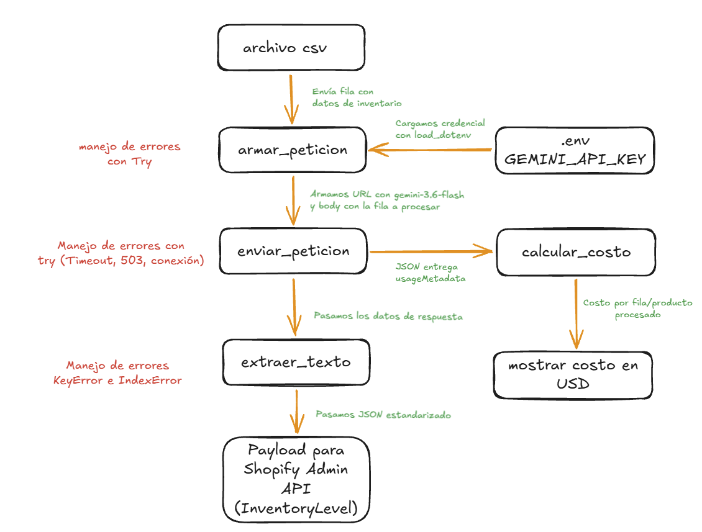

# Decisión de arquitectura: elección de modelo

## Modelo elegido

**gemini-3.6-flash**, para la funcionalidad principal de la miniaplicación (procesamiento y normalización de inventario CSV para Shopify Admin API).

### Justificación
Bajo el marco del triángulo de IA (**Costo, Latencia y Calidad**), donde es necesario priorizar dos aristas en función de la viabilidad técnica del producto, se optó por **Latencia** y **Calidad**:

* **Latencia (Prioridad 1):** Con un promedio de **7,12 segundos** (y registros de hasta 3,50 segundos), demostró ser casi 3 veces más veloz que las alternativas Lite y Flash 3.8 (~19 s - 20 s). En un flujo de sincronización de inventario masivo hacia Shopify, reducir la latencia por fila evita la acumulación de colas y los bloqueos por límite de tiempo de conexión (timeouts).
* **Calidad / Adherencia Estricta (Prioridad 2):** Generó respuestas en JSON directo, minificado y respetando el 100% de las claves requeridas (`sku`, `available_quantity`, `location_id`, `title`) sin añadir wrappers ni texto auxiliar, lo cual garantiza que el payload sea apto para consumo inmediato por la API sin pasos de limpieza adicionales.

El **Costo** se asumió como una variable secundaria aceptable: si bien `gemini-3.5-flash-lite` ofrecía una tarifa por token menor, sacrificar velocidad y estabilidad por una diferencia marginal de costo rompería la experiencia operativa del usuario y la robustez del servicio.

## Diagrama de arquitectura

El flujo completo va desde la entrada de datos de la fila del archivo CSV hasta la respuesta final estructurada en JSON, pasando por `armar_peticion`, `enviar_peticion` (con la credencial `GEMINI_API_KEY` leída desde `.env` y el manejo de errores en `try/except`) y `extraer_texto` (que además calcula el costo a partir de `usageMetadata` con `calcular_costo`). El diagrama completo está en `docs/diagrama-de-arquitectura.png`.

## Comparación de candidatos

| Criterio | gemini-3.6-flash | gemini-3.5-flash-lite | gemini-3.8-flash |
|---|---|---|---|
| Costo por 1000 tokens de entrada | 0,00075 USD | 0,00030 USD | 0,00075 USD |
| Costo por 1000 tokens de salida | 0,00375 USD | 0,00250 USD | 0,00375 USD |
| Latencia promedio observada | 7,12 segundos | 19,07 segundos | 20,78 segundos |
| Calidad de respuesta para el caso | Excelente: JSON estricto, minificado y con las 4 claves exactas | Buena: JSON estructurado válido con saltos de línea | Buena en el único intento exitoso |
| Tasa de éxito en benchmark | 75% (3/4 exitosos, 1 fallo 503) | 75% (3/4 exitosos, 1 fallo 503) | 25% (1/4 exitosos, 3 fallos 503) |
| Fecha de medición | 2026-10-22 | 2026-10-22 | 2026-10-22 |

### Justificación

Para esta miniaplicación de procesamiento de inventario a partir de archivos CSV, la velocidad y la estabilidad fueron los factores determinantes. `gemini-3.6-flash` registró una latencia promedio de 7,12 segundos (con picos óptimos de 3,50 segundos), lo que representa casi un tercio del tiempo observado en `gemini-3.5-flash-lite` (19,07 s) y `gemini-3.8-flash` (20,78 s). Al procesar lotes de filas de productos para actualizar catálogos en Shopify, una latencia reducida previene bloqueos por tiempo de espera en el cliente y garantiza una ejecución fluida. Asimismo, entregó un formato JSON minificado y limpio listo para consumir por la API sin necesidad de etapas adicionales de formateo.

## Alternativa descartada y por qué

Se descartó **gemini-3.8-flash** debido a su alta inestabilidad operativa en el entorno de pruebas (75% de fallos con código de error HTTP 503 por sobrecarga), igualando el costo de `gemini-3.6-flash` sin aportar ventajas en rendimiento. 

Por otro lado, se descartó **gemini-3.5-flash-lite** porque, a pesar de ofrecer un costo ligeramente menor por token, su latencia media cercana a los 20 segundos por fila ralentiza de forma inviable el procesamiento de inventarios, donde el tiempo total de sincronización con Shopify resulta un factor crítico.